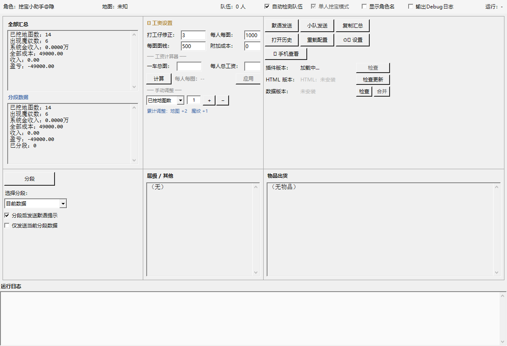
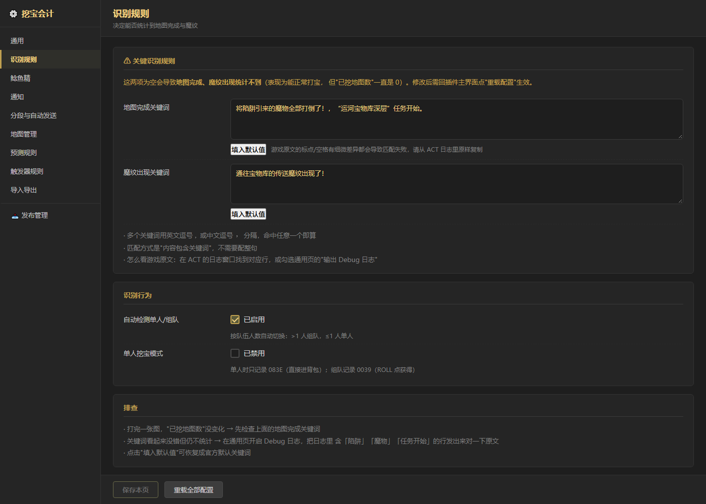

# FF14 挖宝会计 · ACT 插件

[](LICENSE)
[](#系统要求)
[](#系统要求)

一个用于 **FF14（最终幻想14）挖宝玩法**的 [ACT](https://advancedcombattracker.com/) 插件。
读取 ACT 解析出的游戏日志，统计每次挖宝的**地图数、魔纹、出货、层级、系统金**，
计算**工资与盈亏**，支持**分段结算**、**结果预测**、**自动发送**，并提供网页版实时面板。

> 本插件**不读写游戏内存、不注入游戏进程**，只解析 ACT 已经生成的日志文本。

---

## 功能

### 数据统计
- **地图完成数 / 魔纹出现数** — 按游戏提示文字识别
- **物品出货** — 按地图分组展示，支持单价与额外奖励
- **层级记录** — 宝物库层级出现次数
- **系统金收入** — 自动累加
- **耗时统计**

### 成本与收益
- 工资设置：打工仔人数修正、每人每图工资、每图图钱、附加成本
- 工资计算器：由"一车总图 + 每人总工资"反推"每人每图"
- 实时计算 **总成本 / 总收入 / 盈亏**
- 参数变化时自动存档上一阶段（换人、改工资都不会算错）

### 分段结算
- 一键分段：把当前进度存为快照，之后从 0 开始计
- 分段下拉菜单：可回看任意历史分段
- 与旧版 Python 程序的分段语义保持一致

### 结果预测
- 根据已出现的特征码预判宝物库结果（成功/失败）
- 支持自定义规则、超时提醒

### 自动发送
- 挖宝成果一键发送到默语/小队（通过 [鲶鱼精邮差 PostNamazu](https://github.com/Natsukage/PostNamazu) HTTP 接口）
- 自动分段：检测到指定消息时自动创建分段
- 自动发送：检测到指定消息时自动发送汇总

### 网页面板
- 实时悬浮窗（WebSocket 推送，延迟 < 1s）
- 历史查询：按日期回看每次挖宝明细
- **完整设置页**：识别规则、鲶鱼精、通知、分段、地图、预测规则、触发器规则
- **手机查看**：局域网内手机扫码访问

### 其他
- 手动调整：漏记或多记的地图/魔纹可手动 +/− 修正（会影响成本计算）
- 分段后发送默语提示
- Windows 通知

### 常见问题
- [QA文档](docs/ACT挖宝会计插件帮助QA.md)
---

## 界面

**主面板**（含手动调整区）



**设置页 · 识别规则**



---

## 系统要求

| 项目 | 要求 |
|---|---|
| 操作系统 | Windows 10 / 11（推荐 64 位） |
| 运行时 | [.NET Framework 4.7.2](https://dotnet.microsoft.com/download/dotnet-framework/net472) 或更高 |
| 依赖 | [ACT (Advanced Combat Tracker)](https://advancedcombattracker.com/) |
| 游戏 | 国服 FF14（文本为简体中文） |
| 可选 | [鲶鱼精邮差 PostNamazu](https://github.com/Natsukage/PostNamazu)（用于游戏内发送消息） |

---

## 安装

1. 确认已安装 ACT，并且**游戏日志记录**已开启
2. 下载 `FF14TreasureHunterACT.dll`,`Web文件`（单独下载或整合）
3. dll放到 ACT 的插件目录：
   ```
   <ACT安装目录>\Plugins\FF14TreasureHunterACT.dll
   ```
   > 整合包（如呆萌）通常在 `<ACT目录>\ACT.DieMoe\Plugins\`

4. html放到(可不下，但需要从服务器更新):
   ```
   %APPDATA%\FF14TreasureHunter\web 
   ```
5. 启动 ACT → 插件标签页 → 右键 → 启用「挖宝会计」
6. 首次运行会自动创建配置与数据库：
   ```
   %APPDATA%\FF14TreasureHunter\
     ├─ config\settings.json     ← 配置
     ├─ data\events.db           ← 数据库（SQLite）
     └─ log\
   ```

> ⚠️ **不要装在云同步目录里**（如 OneDrive 托管的「我的文档」）。
> 云同步可能把更新后的 DLL 还原成旧版本，导致"更新成功但版本没变"。

---

## 使用

1. 打开 ACT，进入插件面板
2. 游戏内开始挖宝，插件自动统计
3. 需要结算时点「分段」，之后的数据从 0 开始
4. 点「默语发送 / 小队发送 / 复制汇总」输出结果

### 网页面板

插件启动后，主面板会显示地址：

- 悬浮窗：`http://127.0.0.1:8765/`
- 历史记录：`http://127.0.0.1:8765/history.html`
- 设置页：`http://127.0.0.1:8765/settings.html`

端口可在设置页修改（默认 8765，改完需重载插件）。
悬浮窗可以使用ACT自带OverlayPlugin插件，预设：自定义悬浮窗；类型：数据统计。
悬浮窗地址使用：
 ```
 http://127.0.0.1:8765/overlay.html?HOST_PORT=ws://127.0.0.1/fake/
 ```
---

## 配置

配置文件：`%APPDATA%\FF14TreasureHunter\config\settings.json`
**推荐用设置页修改**，手改 JSON 容易出错。

### ⚠ 最重要的两项：识别关键词

```jsonc
{
  "detection": {
    // 地图完成时游戏的提示文字
    "map_complete_keyword": "将陷阱引来的魔物全部打倒了！，“运河宝物库深层”任务开始。",
    // 魔纹出现时的提示文字
    "magic_seal_keyword": "通往宝物库的传送魔纹出现了！"
  }
}
```

**这两项为空会导致地图/魔纹统计不到**（表现为能正常打宝，但"已挖地图数"一直是 0）。

- 支持多个关键词，用 `,` 或 `，` 分隔，命中任意一个即算
- 匹配方式是「内容包含关键词」，不需要配整句
- 游戏更新改了台词时需要同步修改
- 插件启动时会在运行日志打印当前生效的关键词，方便排查

设置页路径：**设置页 → 识别规则**，可点「填入默认值」恢复官方默认值。

### 关键配置项

| 路径 | 说明 |
|---|---|
| `detection.map_complete_keyword` | 地图完成关键词（**必填**） |
| `detection.magic_seal_keyword` | 魔纹出现关键词（**必填**） |
| `detection.auto_single_mode` | 自动检测单人/组队 |
| `detection.single_player_mode` | 单人模式（只记 083E） |
| `postnamazu.port` | 鲶鱼精 HTTP 端口（默认 2019） |
| `ui.overlay_port` | 网页面板端口（默认 8765） |
| `ui.show_player_name` | 是否显示角色名（默认隐藏） |
| `salary.*` | 工资与成本参数 |
| `send.segment_only` | 发送时是否只发当前分段 |
| `money_unit_wan` | 金币是否用"万"显示 |

> 配置缺失的必需项会在启动时**自动补齐**（内置默认值），不会因为配置不全而静默失效。


---

## 常见问题

**打完一张图，「已挖地图数」不增加**
检查设置页 → 识别规则的关键词。启动日志里有 `[识别] 地图完成关键词：...`，
和游戏实际提示文字对比一下（标点、空格差异都会导致匹配失败）。

**网页面板打不开**
端口 8765 被占用，或需要管理员权限。设置页可改端口（改完重载插件）。

**鲶鱼精发送失败 / 偶发丢失**
确认鲶鱼精的「HTTP 服务器」已启用且端口一致（默认 2019）。
插件会自动重试连接失败的发送。

**自动更新提示成功，但重启后版本没变**
最常见原因：插件装在云同步目录（OneDrive/腾讯微云等），
同步客户端把新 DLL 还原成了旧版本。把 ACT 移到非同步目录即可根治。

**杀毒软件报警**
.NET 插件误报较常见。可加入白名单，或自行从源码编译。
---

## 数据与隐私

**所有数据都在本机**，插件不上传任何挖宝记录：

| 数据 | 位置 |
|---|---|
| 配置 | `%APPDATA%\FF14TreasureHunter\config\settings.json` |
| 数据库 | `%APPDATA%\FF14TreasureHunter\data\events.db` |
| 日志 | `%APPDATA%\FF14TreasureHunter\log\` |

- 数据库里有角色名、区服、挖宝记录，**不要提交到 Git**
- 默认隐藏角色名（显示为「挖宝小助手@隐」），可在设置页开启
- 网页面板只监听本机；手机访问需要局域网 token

### 网络请求

插件会**联网**，行为如下（可在设置页关闭自动检查）：

| 目标 | 用途 | 频率 |
|---|---|---|
| `https://heikadi.top/ff14ds/wbkj/ACThtml/version.json` | 检查更新 | 启动时 1 次 |

需要「数据合并」或「插件更新」时才会下载文件。请求头带版本号
（`FF14TreasureHunterACT/<版本>`），不包含任何个人信息。

---

## 免责声明

- 本项目是**非官方第三方工具**，与 SQUARE ENIX 无关。
- 「FINAL FANTASY XIV」及相关名称、商标归 SQUARE ENIX CO., LTD. 所有。
- 本插件只解析 ACT 已生成的日志文本，**不修改游戏内存、不注入进程、不自动操作游戏**。
- 使用第三方工具存在理论上的账号风险，请自行评估后再使用。
- 作者不对因使用本插件导致的任何损失负责。

---
## 后续仅供后续分支或维护者
---

## 构建

### 环境

- Visual Studio 2019/2022（需安装 **.NET 桌面开发** 工作负载）
- .NET Framework 4.7.2 Targeting Pack
- NuGet（还原 `packages.config`）

### 步骤

```powershell
# 1. 还原 NuGet 包
nuget restore FF14TreasureHunterACT.sln

# 2. 编译（需要指定 ACT 安装目录）
msbuild FF14TreasureHunterACT.sln /t:Rebuild /p:Configuration=Release /p:Platform=x64 /p:ActDir="C:\ACTV3"
```

**`ActDir` 说明**：编译需要引用 `Advanced Combat Tracker.exe`。
默认值 `..\..\..\ACTV3` 仅适用于原作者目录结构，其他人用以下任一方式覆盖：

| 方式 | 示例 |
|---|---|
| 命令行 | `/p:ActDir="D:\ACT"` |
| 环境变量 | `set ACT_DIR=D:\ACT` |
| 项目属性文件 | 在同目录建 `ActDir.props`，内容 `<Project><PropertyGroup><ActDir>D:\ACT</ActDir></PropertyGroup></Project>` |

产物：`FF14TreasureHunterACT\bin\x64\Release\FF14TreasureHunterACT.dll`

### 快速自检

编译后把 DLL 放进 ACT 的 `Plugins` 目录启动一次，确认：

1. 插件面板正常显示
2. 运行日志出现 `[识别] 地图完成关键词：...`（非空）
3. 网页面板 `http://127.0.0.1:8765/` 能打开
---

## 发布流程

仓库已配置 GitHub Actions（`.github/workflows/build.yml`）：

| 触发 | 行为 |
|---|---|
| push / PR 到 main | 编译校验 + 引用完整性检查 |
| 推 tag `v*` | 额外：校验 tag 与版本号一致 → 创建 Release → 上传 DLL |
| 手动 workflow_dispatch | 同 push |

**发版步骤**

```powershell
# 1. 改版本号
#    FF14TreasureHunterACT\Properties\AssemblyInfo.cs
#    AssemblyVersion / AssemblyFileVersion → 例如 1.0.4.5

# 2. 提交
git add .
git commit -m "release: 1.0.4.5"
git push

# 3. 打 tag 并推送（tag 必须与程序集版本一致，否则 CI 会失败提醒）
git tag v1.0.4.5
git push origin v1.0.4.5
```

CI 会自动产出 Release，附件包含：

- `FF14TreasureHunterACT.dll`
- `web-pages.zip`（网页面板文件，可选手动安装）

> CI 如何在没有 ACT 的环境里编译：见 [`_ci/README.md`](_ci/README.md)。
> 仓库内有一个 ACT 的「引用桩」，通过公钥签名保证与真实 ACT 的
> 程序集身份完全一致，因此编译产物可直接在真实 ACT 中加载。

---

## 项目结构

```
FF14TreasureHunterACT/
├─ FF14TreasureHunterACT/          C# 源码（.NET Framework 4.7.2 / C# 7.3）
│  ├─ Plugin.cs                    ACT 插件入口
│  ├─ ConfigManager.cs             配置读写（深度合并 + 缺失项自愈）
│  ├─ ConfigDefaults.cs            内置默认配置
│  ├─ LogParser.cs                 ACT 日志行 → 结构化事件
│  ├─ EventProcessor.cs            事件分发：地图/魔纹/出货/层级/系统金
│  ├─ Database.cs                  SQLite 存储
│  ├─ SegmentManager.cs            分段快照
│  ├─ FinancialManager.cs          成本与盈亏
│  ├─ PredictionManager.cs         预测规则
│  ├─ RulesManager.cs              触发器规则
│  ├─ PostNamazuClient.cs          鲶鱼精 HTTP 客户端
│  ├─ OverlayServer.cs             网页服务（HTTP + WebSocket）
│  └─ *UpdateManager.cs            HTML / 数据 / 插件自更新
├─ web/                            网页面板前端
│  ├─ overlay.html                 实时悬浮窗
│  ├─ history.html                 历史查询
│  ├─ settings.html                设置页
│  └─ mobile.html                  手机端
├─ _ci/                            CI 专用（ACT 引用桩，不参与插件运行）
├─ docs/images/                    README 截图
└─ packages/                       NuGet 包（.gitignore 忽略）
```
---
## 关于自动更新

⚠️ **公开发布的构建会自动从本人服务器（`heikadi.top`）更新**。

如果你 fork 或自行构建并分发，建议改掉更新地址，否则你的用户会被更新成主分支（本人）的版本：

| 文件 | 常量 |
|---|---|
| `PluginUpdateManager.cs` | `RemoteBaseUrl` |
| `DataUpdateManager.cs` | `RemoteBaseUrl` |
| `HtmlUpdateManager.cs` | `RemoteBaseUrl` |
| `Plugin.cs` | 更新失败提示里的下载链接 |

---

## 第三方组件

| 组件 | 许可证 | 用途 |
|---|---|---|
| [Newtonsoft.Json](https://github.com/JamesNK/Newtonsoft.Json) | MIT | JSON 序列化 |
| [System.Data.SQLite](https://system.data.sqlite.org/) | Public Domain | 本地数据库 |
| [QRCoder](https://github.com/codebude/QRCoder) | MIT | 手机访问二维码 |

所有依赖均为宽松许可证，与本项目的 MIT 兼容。

---

## 许可证

[MIT](LICENSE) © 2026 Heacter

---

## 贡献

欢迎提 Issue 和 PR。

- Bug 报告请附：插件版本、ACT 版本、运行日志相关片段
- 提交 PR 前请确认 `Debug|x64` 可编译
- 涉及识别关键词（游戏文本）的改动，请说明对应的游戏版本
